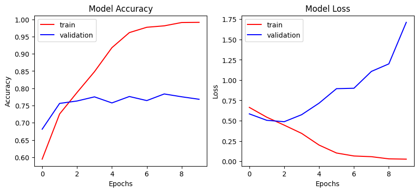
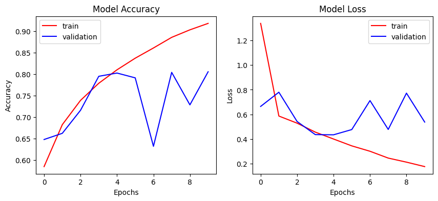
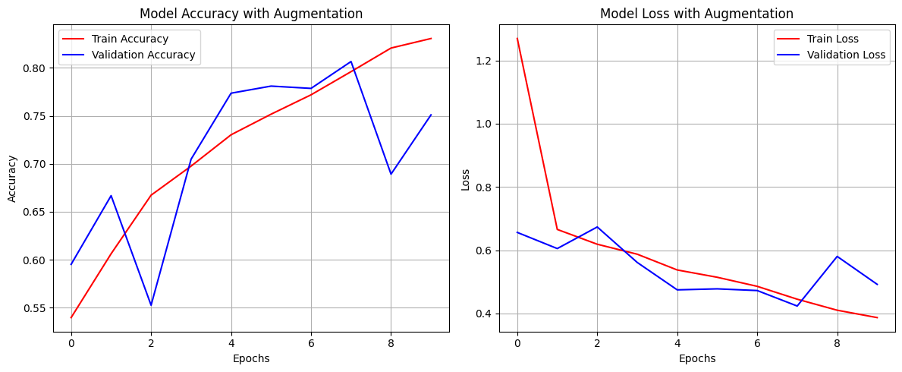

# Cats vs Dogs Image Classification (CNN from scratch)

A binary image classifier built with a custom convolutional neural network (CNN) in Keras. The project walks through a typical overfitting problem and how each fix changed the results: **batch normalization, dropout and data augmentation.**

## Key findings

- A plain 3-block CNN **overfitted severely**: about **99.1% training accuracy** but only **~77% validation accuracy** (a gap of about 22 points), with validation loss rising from 0.49 to 1.71 while training loss fell to 0.03.
- Adding **batch normalization and dropout** raised validation accuracy to about **80.6%** and stabilised the loss, but the gap was still about 11 points.
- Adding **data augmentation** and stronger dropout shrank the gap to about **2.5 points** (training ~83%, validation ~80.6%) and kept validation loss aligned with training loss (about 0.43).
- Augmentation reduced overfitting but **did not raise validation accuracy beyond ~80.6%**, which suggests this small CNN trained from scratch has reached its limit. **Transfer learning** is the natural next step.

## Dataset

- Kaggle cats vs dogs dataset: about **25,000 labelled images** (cats and dogs) — [Kaggle Dogs vs. Cats (`salader/dogsvscats`)](https://www.kaggle.com/datasets/salader/dogsvscats) (check dataset terms on Kaggle before external use).
- Split: **20,000 training** and **5,000 validation** images.
- Preprocessing: images resized to 256 x 256 and pixel values scaled to the 0-1 range.

## Model

- **Architecture:** 3 convolutional blocks with **32, 64 and 128 filters**, each followed by max pooling, then fully connected (Dense) layers and a **sigmoid** output neuron.
- **Loss / optimiser:** binary cross-entropy, Adam.

## Experiments

| Experiment | What changed | Train acc | Validation acc | Gap | Validation loss |
|---|---|---|---|---|---|
| 1. Baseline | Plain 3-block CNN | 99.1% | ~77% | ~22 pts | rose from 0.49 to 1.71 |
| 2. Regularised | Batch normalization after every conv layer + Dropout 0.1 | ~91.8% | ~80.6% | ~11 pts | ~0.44 (best, around epoch 4-5) |
| 3. Augmented | Experiment 2 + data augmentation (random flip, rotation 0.1, zoom 0.1) + Dropout 0.3 | ~83% | ~80.6% (peak around epoch 7) | ~2.5 pts | ~0.43, close to training loss |

Training accuracy dropped in experiment 3, which is expected: augmentation and dropout stop the model from memorising the training images. The important change is the much smaller gap between training and validation.

| Baseline | Regularised | Augmented |
|---|---|---|
|  |  |  |

## What I learned

- **Accuracy alone can hide overfitting.** Validation **loss** showed the problem earlier and more clearly than accuracy did.
- Each regularisation technique addressed a different issue: **batch normalization** stabilised training, **dropout** reduced co-adaptation of neurons, and **augmentation** gave the model more varied examples.
- A smaller train-validation gap does not automatically mean a more accurate model.

## Limitations

- There is **no separate test set**: the 5,000 validation images were used to compare experiments and for early stopping, so the reported validation numbers are slightly optimistic.
- Results come from a **single run** per experiment; numbers can vary by a point or two between runs.
- The model is trained from scratch on a modest dataset and was **not deployed**.

## Future work

- **Transfer learning** with a pretrained model (for example MobileNetV2 or ResNet50), expected to improve accuracy substantially on this kind of task
- A proper held-out test set and repeated runs
- Error analysis: look at misclassified images to see what the model confuses
- A small demo app

## How to run

1. Open `notebook/Dog_vs_Cat_CNN.ipynb` in Google Colab (GPU runtime recommended).
2. Download the dataset from Kaggle (a Kaggle API token is needed; store it in Colab Secrets and never in the notebook).
3. Run the cells in order.

```bash
pip install tensorflow matplotlib
```

## Repository structure

```
Dog_vs_Cat_CNN/
├── README.md
├── notebook/
│   └── Dog_vs_Cat_CNN.ipynb   # data loading, model, experiments
└── assets/                    # training curves
    ├── curves_baseline.png
    ├── curves_regularised.png
    └── curves_augmented.png
```

## Tech stack

Python, TensorFlow/Keras, Matplotlib, Google Colab.
